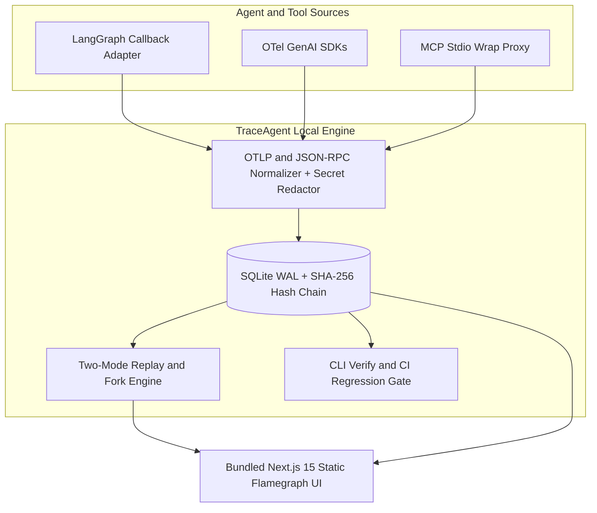

# TraceAgent

**The local-first Flight Recorder, SHA-256 Audit Ledger, and Time-Travel Replay Debugger for AI Agents (LangGraph & MCP).**

[](https://github.com/rounakkumarsah/traceagent/actions/workflows/ci.yml)
[](https://www.python.org/)
[License: MIT](https://www.google.com/search?q=LICENSE)
[](#architecture)

---

## What Is TraceAgent? (Plain-English Explanation)

Think of **TraceAgent** as an **Airplane Black Box + Time-Travel Undo Button** for AI agents.

When an AI agent runs a 10-step workflow (planning → querying a database → calling an MCP tool → issuing a refund) and crashes at **Step 6**, developers normally have to re-run the entire agent from **Step 1** just to test a small fix—burning time and paying LLM API token bills over and over again.

**TraceAgent solves four problems out of the box:**
1. **100% Local & Private ($0 Cloud):** Every LLM call, MCP tool call, token count, and latency metric is stored in a local SQLite WAL database (`~/.traceagent/ledger.db`). Sensitive prompts and payloads never leave your machine or private VPC.
2. **Time-Travel Replay & Forking:** Inspect every step in a visual flamegraph UI, edit a broken tool output at Step N, and replay downstream code at **$0.00 token cost**—or fork a live run from Step N without re-paying for Steps 1 to N−1.
3. **Tamper-Evident Compliance Audit Trail:** Every recorded step is cryptographically chained to the previous step using **SHA-256**. If anyone edits even a single byte in the database, `traceagent verify` catches the exact corrupted step.
4. **CI/CD Cost & Regression Blocker:** Fail pull requests automatically in GitHub Actions if a prompt or code change introduces new tool errors or spikes token usage past your budget.

---

## Try It in 10 Seconds (Zero API Keys Required)

Install directly from GitHub and launch the built-in offline demo (zero Docker, zero Node.js, zero API keys):

```bash
pip install git+https://github.com/rounakkumarsah/traceagent.git
traceagent demo
```

*(On Windows systems where `.exe` shims are restricted, run `python -m traceagent.cli demo`.)*

Open the local URL printed in your terminal (default `http://127.0.0.1:8765` or `http://127.0.0.1:8000`):
1. Select **`order-refund-agent`** (`demo-langgraph-mcp-001`)—a pre-recorded 7-step LangGraph + MCP trajectory that crashes at **Seq #6** because **Seq #5** returned truncated JSON.
2. Click **Seq #5 (`mcp:fetch_payment_intent`)** in the waterfall.
3. Fix the JSON in the right-hand editor to:
   ```json
   {"intent_id": "pi_8821", "amount_usd": 49.0}
   ```
4. Click **Fork & Replay from Seq #5** (in **Deterministic Stub Replay** mode) and watch **Seq #6** turn green with **`0` tokens burned** and **`SHA-256 CHAIN: VALID`**.

---

## How to Connect Your Real Agents & MCP Servers

TraceAgent does not spy on unrelated OS processes. Connect it **once** using any of the three 1-line integrations below—after that, every execution is recorded automatically.

### Option 1: Wrap Any Real MCP Server (Zero Code Changes)

Prefix your existing MCP server command with `traceagent wrap --`. TraceAgent acts as a transparent JSON-RPC 2.0 stdio proxy (all TraceAgent logs go strictly to `stderr` so `stdout` is never corrupted).

**CLI example:**
```bash
traceagent wrap -- npx -y @modelcontextprotocol/server-filesystem ./
```

**Claude Desktop / Cursor / Antigravity `mcp.json` example:**
```json
{
  "mcpServers": {
    "filesystem": {
      "command": "traceagent",
      "args": ["wrap", "--", "npx", "-y", "@modelcontextprotocol/server-filesystem", "/path/to/workspace"]
    }
  }
}
```
Then open the UI anytime with:
```bash
traceagent serve
```

---

### Option 2: Connect a Real LangGraph / Python Agent (1-Line Callback)

Attach `TraceAgentCallbackHandler` to any LangGraph `invoke()` or `astream()` call:

```python
from traceagent.adapters.langgraph import TraceAgentCallbackHandler

handler = TraceAgentCallbackHandler(trace_name="customer-support-agent")
result = graph.invoke(
    {"messages": [("user", "Check refund status for ORD-9042")]},
    config={"callbacks": [handler]},
)
```

---

### Option 3: Connect Any OpenTelemetry (`gen_ai.*`) Application (1 Env Var)

Start the local OTLP HTTP/JSON receiver and UI:

```bash
traceagent serve --host 127.0.0.1 --port 8765
```

Point any OpenTelemetry-instrumented app (OpenAI, Gemini, Anthropic, CrewAI, AutoGen, OpenLLMetry, OpenInference) to your local endpoint:

```bash
export OTEL_EXPORTER_OTLP_ENDPOINT=http://127.0.0.1:8765
```

TraceAgent ingests `POST /v1/traces`, normalizes `gen_ai.operation.name`, `gen_ai.request.model`, `gen_ai.usage.input_tokens`, `gen_ai.usage.output_tokens`, and `mcp.tool.name`, and masks common API key patterns (`sk-...`, `AIza...`, `ghp_...`, `Bearer ...`) before writing to disk.

---

## Honest Two-Mode Replay & Forking

TraceAgent strictly separates stubbed code replay from live LLM execution so you never confuse mocked runs with live model behavior:

| Mode | Token Cost | What It Executes | Best Used For |
| :--- | :--- | :--- | :--- |
| **Mode 1: Deterministic Stub Replay (`stub_replay`)** | **$0.00 (`0` tokens)** | Replays cached Steps `0..N−1`, injects your edited Step `N` payload, and runs your Python tool parsers, JSON validators, and routing assertions offline. | Debugging crashes, verifying parser/schema fixes, and fast offline CI tests. |
| **Mode 2: Time-Travel Live Fork (`live_fork`)** | **Saves Steps `0..N−1` tokens** | Replays Steps `0..N−1` from SQLite (`$0.00`), injects your edited Step `N` payload, and calls your configured live/local LLM (`LiveRunner`) only from Step `N+1` onward. | Testing real LLM behavior after a prompt or tool change without paying for earlier steps. |

*(If no `LiveRunner` provider is configured, Mode 2 explicitly returns HTTP `400` instead of faking an LLM response.)*

---

## Cryptographic Audit Verification & CI Regression Gate

### Verify Tamper-Evident SHA-256 Chain
```bash
# Verify a single trace
traceagent verify demo-langgraph-mcp-001

# Verify every trace in your ledger
traceagent verify --all
```
- Exit code `0`: Chain is intact from genesis (`0000...0000`).
- Exit code `1`: Tampering detected—prints the exact corrupted `seq`.

### Block Token & Tool-Error Regressions in GitHub Actions
```bash
traceagent check out/latest_run.jsonl \
  --golden tests/fixtures/golden_trace.jsonl \
  --max-token-increase-pct 15
```

**Drop-in GitHub Actions step:**
```yaml
- name: TraceAgent Regression Gate
  run: |
    traceagent verify --all
    traceagent check current.jsonl --golden baseline.jsonl --max-token-increase-pct 15
```

---

## Architecture

````markdown


---

## Reproducible Local Benchmarks

Run `python scripts/benchmark_replay.py` on your own machine to reproduce these measurements:

**Measured Environment:** Python 3.12.10 | Windows 11 | Intel64 CPU

| Benchmark | Workload | Measured Result |
| :--- | :--- | :--- |
| **SQLite WAL + SHA-256 Write** | 1,000 sequential steps (`~1 KB` JSON each) | P50: `4.85 ms/step` · P95: `5.41 ms/step` · `203 steps/sec` |
| **Full Audit Chain Verification** | Verify SHA-256 chain from genesis (1,000 steps) | `9.17 ms` |
| **Mode 1 Deterministic Stub Replay** | Fork & diff 20-step trajectory from Step 14 | `111.82 ms` (`$0.00` / `0` tokens burned) |

---

## CLI Command Reference

| Command | Description |
| :--- | :--- |
| `traceagent demo` | Seeds the 7-step crash fixture and starts the local UI with zero API keys. |
| `traceagent serve [--host 127.0.0.1] [--port 8765]` | Starts the OTLP `/v1/traces` receiver and bundled flamegraph web UI. |
| `traceagent wrap -- <mcp_cmd...>` | Proxies any stdio MCP server transparently and logs all JSON-RPC tool calls. |
| `traceagent verify [trace_id \| --all]` | Recomputes SHA-256 hash chains and exits non-zero on any byte modification. |
| `traceagent check <candidate> --golden <golden>` | Fails CI on new tool errors, missing required tools, or token-budget spikes. |

---

## Security & Architecture Docs

- **Threat Model & Local-First Guardrails:** [docs/security/STRIDE.md](https://www.google.com/search?q=docs/security/STRIDE.md) (localhost-only default bind, `10 MB` ingest cap, automatic API-key redaction, no `shell=True` subprocess calls).
- **Architecture Decision Records:** [docs/adr/](https://www.google.com/search?q=docs/adr/) (`001-sqlite-wal-hash-chain.md`, `002-two-mode-replay-honesty.md`, `003-bundled-static-ui.md`).

---

## Enterprise Integration & Support

Need custom LangGraph/MCP harness hooks, PostgreSQL multi-tenant audit ledgers, air-gapped VPC deployment, or CI regression gates integrated into your team's pipeline?

- **Author:** Rounak Kumar Sah ([GitHub](https://github.com/rounakkumarsah) • [LinkedIn](https://www.linkedin.com/in/rounak-kumar-sah))
- **Email:** `rounakkrsah429@gmail.com`
- **License:** [MIT](https://www.google.com/search?q=LICENSE)
